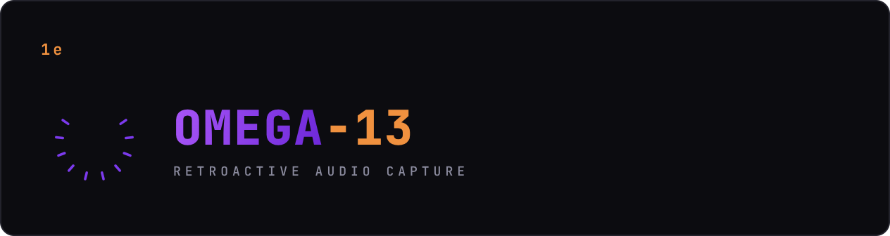

# Omega-13



Omega-13 is a headless retroactive audio daemon: it keeps the last 13 seconds of audio in a RAM-resident ring buffer, and on a trigger it freezes that buffer into a WAV, transcribes it, and routes the text to your clipboard, a scratchpad window, or a dated markdown note. Version 2.7.5 declares `requires-python = ">=3.12"` (pyproject.toml:6), installs the `omega13` console script as `omega13.app:main` (pyproject.toml:20-21), and pins its version string at `__version__ = "2.7.5"` (src/omega13/__init__.py:20) and in pyproject.toml:3.

---

## The Origin Story

The baseline inspiration for this was Steve Harris's `time machine` — as I recall, an old JACK application with a GTK2 overlay that captured the last 10 seconds of the audio buffer when you hit record. *(Unverified lineage — Escape hatch: consult the upstream `time machine` source before citing the GTK2 overlay or the 10-second figure.)* He built it to emulate an old mini-disc recorder for studio riffing.

I applied that concept to a dictation pipeline. If I start rambling into the microphone to capture notes and forget to hit the hotkey, the thought is gone. I wanted to see how large a buffer I could maintain without impacting system performance. I bumped it from 10 to 13 seconds; the ring costs `samplerate x 13 x 2 channels x float32` — under 5 MiB at 48 kHz (src/omega13/audio.py:42-43) — and the value Omega-13 pins today is the module constant `BUFFER_DURATION = 13` at src/omega13/audio.py:16. *(Unprofiled: the callback's CPU cost at longer durations is unmeasured. Escape hatch: profile a 30-second buffer against this baseline before raising `BUFFER_DURATION`.)* (As for the name: while brainstorming the hotkey toggle flow, my partner pointed out the 13-second rollback sounded exactly like the Omega-13 device from *Galaxy Quest*.)

I haven't worked out the math for sustaining a much longer buffer without affecting the pipeline flow, and there are times I've neglected to hit the button for more than 13 seconds. That gap is why the auto-record threshold exists: a 13-second retroactive buffer for manual triggers, an RMS threshold for longer rambles, and immediate writes to temporary session space (src/omega13/core/recording_events.py:217) cover the major failure modes where dictation would otherwise be lost.

---

## What Omega-13 Does

Short version: a retroactive audio daemon that runs as a systemd user service, buffers in memory, and touches no disk with audio data until a capture fires. The AudioEngine runs a JACK client named `Omega13` (src/omega13/audio.py:31) that registers `DEFAULT_CHANNELS = 2` input ports (src/omega13/audio.py:17); its process callback copies each JACK block into a scratchpad, updates peak and RMS meters, and appends the block to the ring buffer (src/omega13/audio.py:186-226). On capture, `start_recording` reconstructs the ring into a linear segment — everything from the write pointer forward is the oldest audio; everything behind it, the newest (src/omega13/audio.py:256-260) — and a writer thread produces the WAV; an ffmpeg pipeline then trims silence at the configured end threshold and downsamples the file to 16 kHz mono (src/omega13/audio.py:356-367). The processed WAV lands in the current session's `recordings/` directory under a sequential name — `001.wav`, `002.wav`, and so on (src/omega13/session.py:88-92).

That 16 kHz mono figure is the format the processing pipeline delivers to every provider (src/omega13/audio.py:362-365); whether a given backend *requires* exactly 16 kHz is not pinned in code. *Escape hatch: feed a 44.1 kHz stereo WAV to each configured provider and compare transcripts.* If `transcription.auto_transcribe` is true — the default (src/omega13/config.py:36) — the stop event hands the WAV to `RecordingEventHandler.register_and_transcribe` (src/omega13/core/recording_events.py:217), which registers it with the session and starts the transcription worker; when the WAV sits under a session's `recordings/` directory the worker writes the transcript to `transcriptions/<stem>.md` in the same session (src/omega13/transcription.py:462-467); audio outside a session gets a sibling `.md` file instead (:466-467, written at :469-471). Three further output routes exist, and all three default to off: `copy_to_clipboard: false` (src/omega13/config.py:47), `inject_to_active_window: false` (src/omega13/config.py:48), and `write_to_file: false` (src/omega13/config.py:49). Enable the first and the worker copies through the pyperclip-backed clipboard module (src/omega13/clipboard.py; pyperclip is a declared dependency at pyproject.toml:12); enable the second and it types the text into a window titled "Whisp" via ydotool (`inject_text`, src/omega13/injection.py:131-194; typing command at :175); enable the third and it appends `[HH:MM:SS] text` to a `YYYY-MM-DD.md` daily file in the directory you configure (src/omega13/file_output.py:33-46). The three routes dispatch sequentially inside the transcription worker's daemon thread (src/omega13/transcription.py:469-497) — not in a forked process.

---

## The Architecture

This is a headless daemon first; the UI is an overlay. Four components carry the load:

- *Audio Engine* (`src/omega13/audio.py`). Hooks into JACK through the `Omega13` client (src/omega13/audio.py:31); captures raw float32 into a ring buffer sized `samplerate * 13` (src/omega13/audio.py:42-43); the JACK callback is zero-allocation, drawing on pre-allocated scratchpads and a 2000-block buffer pool (src/omega13/audio.py:46-66).
- *State Machine* (`src/omega13/recording_controller.py`). Five states — `IDLE`, `ARMED`, `RECORDING_MANUAL`, `RECORDING_AUTO`, `STOPPING` (src/omega13/recording_controller.py:19-25) — and seven events — `AUTO_STARTED`, `AUTO_STOPPED`, `MANUAL_STARTED`, `MANUAL_STOPPED`, `SILENCE_DETECTED`, `SIGNAL_DETECTED`, `STATE_CHANGED` (src/omega13/recording_controller.py:28-36). The class docstring pins the exact transition table: `ARMED → signal > begin_threshold → RECORDING_AUTO`, `RECORDING_AUTO → silence > duration → STOPPING → ARMED`, and so on (src/omega13/recording_controller.py:40-52). RMS-based silence detection controls the auto transitions; `SignalDetector` computes RMS over a 100 ms window (src/omega13/signal_detector.py:34) and exposes the per-channel `rms_levels` array (src/omega13/signal_detector.py:83).
- *IPC & D-Bus*. Wayland is locked down, so Omega-13 speaks two distinct D-Bus domains:
  - `org.omega13.Recorder` — the daemon's public interface, published under bus name `org.omega13.Recorder` at object path `/org/omega13/Recorder` (src/omega13/headless_service.py:52-54). It provides methods `ToggleRecording() -> b` (src/omega13/headless_service.py:78), `RetryTranscription() -> b` (:131), `RetryFailedTranscriptions() -> i` (:143), `GetFailedTranscriptionCount() -> i` (:155), `SetAutoRecordEnabled(b)` (:167), `SetAutoRecordThreshold(d)` (:176), `SetOSDEnabled(b)` (:188), `GetState() -> s` (:193), and `GetHealth() -> a{sv}` (:238); it emits the signals `RecordingToggled(b)` (:250), `OSDStateChanged(ssi)` (:259), and `HealthStatus(a{sv})` (:270). The health signal fires on a 30-second loop (`HeadlessOmega13._periodic_health_status`, src/omega13/headless_service.py:751-754).
  - `org.gnome.Shell.Extensions.Omega13` — the GNOME extension's interface, exported at object path `/org/gnome/Shell/Extensions/Omega13` on the GNOME Shell process's own session-bus connection (gnome-extension/omega13@b08x.github.io/dbus.js:31). The extension owns no bus name of its own, which is why callers address the Shell's well-known name `org.gnome.Shell` — exactly how the injection module calls it (src/omega13/injection.py:52-56).
- *Output Routing*. `ydotool` for text injection (requires `/dev/uinput` and a running `ydotoold`), pyperclip for the clipboard (pyproject.toml:12), native file I/O for the daily markdown note (src/omega13/file_output.py:33-46). All of it runs inside the transcription worker thread after a transcript returns (src/omega13/transcription.py:469-497).

---

## Abstraction Leaks & Trade-offs

If you're building functional Linux desktop tools right now, you're going to hit the Wayland security model. Here's where I ran into trouble and how the code handles it:

- *Targeted Window Injection*. Injecting long-winded transcriptions into whatever window happens to be active is dangerous; if you get distracted and change focus, you dump a paragraph into a terminal session. So injection strictly targets a scratchpad application titled "Whisp" through a three-step focus chain: first `busctl` calls `FocusWindow s "Whisp"` on the Omega-13 extension (src/omega13/injection.py:47-56); second, `de.lucaswerkmeister.ActivateWindowByTitle.activateBySubstring` (src/omega13/injection.py:70-79); third, a `org.gnome.Shell.Eval` JavaScript actor search that requires unsafe mode (src/omega13/injection.py:90-93). If all three fail, injection aborts entirely before any typing occurs — a fail-safe, not a best-effort (src/omega13/injection.py:158-161). Before typing, the text is preprocessed: a trailing "return" becomes two newlines, a trailing "new line" becomes one (src/omega13/injection.py:147-153). The typing itself is `ydotool type --key-delay 2 --key-hold 2` under a 300-second timeout (src/omega13/injection.py:177-184).
- *OSD Subprocess Model & Fallbacks*. Native GTK4 Layer Shell (`zwlr_layer_shell_v1`) does not work on Mutter, so `OSDManager.start_subprocess` skips the GTK4 subprocess entirely when `XDG_CURRENT_DESKTOP` contains "GNOME" (src/omega13/ui/osd.py:291-294). On non-GNOME compositors it spawns `python -m omega13.osd_process` (src/omega13/ui/osd.py:296-302) — the OSD runs as a separate `Gtk.Application` process (id `org.omega13.osd.process`, src/omega13/osd_process.py:17) so its GLib loop stays out of the daemon's threads. *Escape hatch: the blocking claim is asserted from design experience, not a logged anomaly — reproduce it by running the GTK loop on the audio thread and watching for JACK xruns in `journalctl --user -u omega13`.* That subprocess receives state updates over D-Bus, not standard input: it installs an AddMatch rule for the daemon's `OSDStateChanged` signal and repaints on arrival (src/omega13/osd_process.py:30-40). On GNOME the Cairo OSD lives in the extension instead (gnome-extension/omega13@b08x.github.io/osd.js); where neither surface is available, the manager falls back to `notify-send`-style desktop notifications with sound cues (src/omega13/ui/osd.py:377-388).
- *Audio Routing*. You need JACK or the `pipewire-jack` bridge. At startup the daemon connects your saved input ports, and when none are saved it resolves the PulseAudio default source with `pactl get-default-source` and matches it against JACK capture ports (`HeadlessOmega13.initialize`, src/omega13/headless_service.py:400-425). If your audio graph is mis-wired at the system level, you capture silence — and the daemon reports the condition instead of masking it: `ToggleRecording` raises `org.omega13.Recorder.NoAudioActivity` when there is neither recent signal nor any connected port (src/omega13/headless_service.py:92-96). The daemon can't fix your routing.

---

## Requirements

- Python 3.12+ (pyproject.toml:6), managed by `uv` (install.sh bootstraps it, install.sh:60-66)
- JACK or the PipeWire-JACK bridge running
- `ydotool` + the `ydotoold` daemon, if you want text injection
- GNOME Shell 45 through 50 for the native OSD and the window-focus bypass (`shell-version`, gnome-extension/omega13@b08x.github.io/metadata.json:5-12)
- A transcription backend: a local GGUF model (provider `"local"`, the default, src/omega13/config.py:38), a `whisper-server` at `http://localhost:8080` (src/omega13/config.py:39), or a `GROQ_API_KEY` in the environment (`ConfigManager.get_groq_api_key`, src/omega13/config.py:215-219)

---

## Setup

The installer runs as your normal user — it refuses to run as root (install.sh:17-19) — and requests `sudo` itself for the system-dependency step via `dnf`, `apt-get`, or `pacman` (install.sh:33-53). Start it with:

```bash
git clone https://github.com/b08x/omega-13.git
cd omega-13
./install.sh
```

`just install` is *not* the installer — that recipe prints a redirect message and exits 1 (Justfile:7-10); the heavy lifting lives in `./install.sh`. The shell script performs five steps and then hands off: it detects your distribution (install.sh:22-29); installs system dependencies via `dnf`, `apt-get`, or `pacman` (install.sh:31-58); bootstraps `uv` via `curl` from astral.sh (install.sh:60-66); creates a virtualenv and runs `uv sync` (install.sh:68-79); then executes `.venv/bin/python -m omega13.installer "$@"` (install.sh:83-86). The Python installer sequences seven steps — preflight checks, build ydotool, build transcribe-cpp, deploy application, install systemd service, install GNOME extension, summary (src/omega13/installer/main.py:1-11; `TOTAL_STEPS = 7`, src/omega13/installer/main.py:29).

Five of those steps deserve their mechanics stated plainly. The transcribe-cpp build configures CMake with `-DTRANSCRIBE_BUILD_SHARED=ON`, adds `-DTRANSCRIBE_CUDA=ON` when CUDA hardware is detected, and adds `-DTRANSCRIBE_VULKAN=ON` when `libvulkan.so` is present (src/omega13/installer/steps/transcribe.py:69-90; hardware detection runs in preflight, src/omega13/installer/steps/preflight.py:118-119). The ydotool step enables `systemctl --user enable --now ydotoold` when the daemon is missing (src/omega13/installer/steps/ydotool.py:65-77). The deploy step rsyncs the application to `~/.local/share/omega13` and symlinks `~/.local/bin/omega13` (src/omega13/installer/steps/deploy.py:1-6), and the GNOME extension is installed under the uuid `omega13@b08x.github.io` (src/omega13/installer/steps/gnome.py:16). The systemd unit is generated at install time rather than shipped — the template points `ExecStart` at the deployed venv binary with `--no-daemon` and imports `DISPLAY` and `WAYLAND_DISPLAY` into the unit environment (src/omega13/installer/steps/systemd.py:2-4, :21-37).

To download models, use the dedicated command:

```bash
just model dl
```

This launches a `gum`-based interactive menu offering three GGUF models — `nemotron-3.5-asr-streaming-0.6b`, `parakeet-unified-en-0.6b`, and `whisper-large-v3-turbo` (Justfile:38-41); each downloads as `<model>-Q8_0.gguf` from `huggingface.co/handy-computer/<model>-gguf` into `~/.local/share/omega13/models` (Justfile:38-47), and the recipe writes your chosen default plus `local_model_path` and `local_model_threads` straight into `config.json` (Justfile:55-71).

*Crucial step*: the GNOME extension doesn't enable itself. Run:

```bash
gnome-extensions enable omega13@b08x.github.io
```

*(On Wayland, if the extension is missing after install, log out and back in, then confirm with `gnome-extensions list` before enabling.)*

There is no `just check` recipe. The Justfile defines exactly `install`, `test`, `dev`, `toggle`, `model`, `rpm-lint`, `rpm-srpm`, and `rpm-build` (Justfile:7-83); environment verification is the installer's preflight step (src/omega13/installer/main.py:1-11) and the test suite (Justfile:13-17). To remove everything, `./uninstall.sh` drives the installer's uninstall routine (`run_uninstall`, src/omega13/installer/main.py:26).

### RPM Packaging (Fedora & EPEL)

Production RPM spec files and automation tooling shipped in 2.7.5 under `packaging/rpm/`: `omega13.spec`, `python-transcribe-cpp.spec`, `python-JACK-Client.spec`, `python-dbus-next.spec`, `ydotool.spec`, the `build.sh` driver, and the systemd/D-Bus service units. The drive commands:

```bash
just rpm-lint    # validate all spec files   (Justfile:75)
just rpm-srpm    # build Source RPMs        (Justfile:79)
just rpm-build   # build binary RPMs         (Justfile:83)
```

Under the RPM layout the unit runs `ExecStart=/usr/bin/omega13 --no-daemon` with `WantedBy=default.target` (packaging/rpm/omega13.service:9, :14), and D-Bus activation is wired through `packaging/rpm/org.omega13.Recorder.service` with `SystemdService=omega13.service` (packaging/rpm/org.omega13.Recorder.service:1-4).

---

## Running It

Start the daemon:

```bash
systemctl --user start omega13
systemctl --user enable omega13
```

Check the logs when it breaks:

```bash
journalctl --user -fu omega13
```

Health status arrives on the same 30-second loop (src/omega13/headless_service.py:751-754); a quiet journal does not by itself mean the daemon is dead.

Foreground mode, stated exactly: `--no-daemon` is parsed at src/omega13/app.py:28 and *never read afterwards* — `args.daemon` is a backwards-compatibility no-op kept for existing scripts and for the service units, which pass it on their ExecStart lines (packaging/rpm/omega13.service:9). Pass none of the five control flags and `main()` runs the headless service in the foreground of its own process via `main_headless()` under a PID-file guard at `/tmp/omega13.pid` (src/omega13/app.py:128-133); each control flag exits over D-Bus or the PID file before that block (app.py:41-122); systemd, not Omega-13, is the daemonizer.

---

## Control

Eight CLI flags exist, with these exact help strings (src/omega13/app.py:15-30):

| Flag | Help string |
| --- | --- |
| `--toggle` | Toggle recording on a running instance via D-Bus (app.py:15) |
| `--stop` | Stop a running instance (app.py:18) |
| `--retry` | Retry the last failed transcription via D-Bus (app.py:21) |
| `--status` | Check if Omega-13 is running (app.py:24) |
| `--daemon` | Run as background daemon (default) (app.py:27) |
| `--no-daemon` | Run in foreground without daemonizing (app.py:28) |
| `--config` | Launch the interactive configuration wizard (app.py:29) |
| `--log-level` | Set logging level — default `INFO` (app.py:30) |

Send the capture signal with `omega13 --toggle`, which reaches the daemon's `ToggleRecording() -> b` method over D-Bus (src/omega13/headless_service.py:78). The in-daemon global hotkey defaults to `<ctrl>+<alt>+space` (src/omega13/config.py:33) and is normalized by `_resolve_hotkey` (src/omega13/hotkeys.py:41-92); on Wayland, pynput cannot capture global hotkeys reliably, and the listener logs exactly that warning — map a compositor or system-wide hotkey to `omega13 --toggle` instead (src/omega13/hotkeys.py:106-112).

### Settings

The config lives at `~/.config/omega13/config.json` (src/omega13/config.py:19-22). The only interactive configuration surface is the `--config` wizard (src/omega13/app.py:29), a `rich`-based menu covering audio input ports, the hotkey, auto-record, transcription, and output destinations (src/omega13/config_ui.py:14-223). On "Exit & Apply" the wizard restarts the daemon via `systemctl --user restart omega13.service` (src/omega13/config_ui.py:175-186, invoked at :216-219).

```json
{
  "transcription": {
    "provider": "local",
    "server_url": "http://localhost:8080",
    "copy_to_clipboard": false,
    "inject_to_active_window": false,
    "write_to_file": false
  },
  "sessions": {
    "temp_root": "/run/user/1000/omega13",
    "default_save_location": "~/Recordings",
    "auto_cleanup_days": 7
  },
  "auto_record": {
    "enabled": false,
    "begin_threshold_db": -35.0,
    "end_threshold_db": -35.0,
    "silence_duration_seconds": 10.0
  }
}
```

Every key above matches a default in the code: the transcription block at src/omega13/config.py:34-50, the sessions block at src/omega13/config.py:57-61, the auto-record block at src/omega13/config.py:62-67.

---

## Workflow

Two capture modes cover the failure cases, and both end in the same session bookkeeping.

1. *Manual Capture.* `omega13 --toggle` (or the `Ctrl+Alt+Space` default hotkey at src/omega13/config.py:33) calls `ToggleRecording` over D-Bus (src/omega13/headless_service.py:78); starting a manual recording prepends the full 13-second ring — the retroactive part (src/omega13/audio.py:256-260) — and a second toggle stops it, fires `MANUAL_STOPPED`, and hands the WAV to `register_and_transcribe` (src/omega13/core/recording_events.py:217).
2. *Auto-Record Mode.* Arming happens three ways: set `auto_record.enabled` in config (default `false`, src/omega13/config.py:63), call `SetAutoRecordEnabled(b)` on D-Bus (src/omega13/headless_service.py:167), or flip the *Auto-Record* switch in the extension's panel menu (gnome-extension/omega13@b08x.github.io/extension.js:34-36). Once armed, the state machine watches the RMS: input crossing `begin_threshold_db` — default `-35.0` dB (src/omega13/config.py:64) — starts `RECORDING_AUTO`; input staying below `end_threshold_db` — default `-35.0` dB (src/omega13/config.py:65) — for `silence_duration_seconds` — default `10.0` s (src/omega13/config.py:66) — stops it and re-arms (src/omega13/recording_controller.py:40-52). The threshold is adjustable at runtime through `SetAutoRecordThreshold(d)` (src/omega13/headless_service.py:176) or the extension slider, which maps 0..1 to −60.0..0.0 dB (gnome-extension/omega13@b08x.github.io/extension.js:41-46).
3. *Save flow, stated exactly.* On every stop, `register_and_transcribe` registers the WAV with the current session (src/omega13/core/recording_events.py:217-246) and, when the WAV sits under the session's `recordings/` directory, the transcription worker writes the transcript to `transcriptions/<stem>.md` in that session (src/omega13/transcription.py:462-467); audio outside a session gets a sibling `.md` file instead (:466-467, written at :469-471). *Nothing in the daemon's entry chain promotes a session to permanent storage*: neither `app.py`, nor `headless_service.py`, nor `core/recording_events.py` ever calls `SessionManager.save_session` (src/omega13/session.py:294), the method that marks a session saved and copies it into `sessions.default_save_location` — its incremental helper `_sync_to_save_location` (src/omega13/session.py:164-192) runs only after that call — `~/Recordings` by default (src/omega13/config.py:59). So captures and transcripts accumulate under the temp root, and `~/Recordings` receives nothing automatically. *Rationed uncertainty:* no caller of `save_session`, `get_default_save_location`, or `cleanup_old_sessions` exists anywhere I read in `src/`, but I have not audited every module exhaustively. *Escape hatch:* run `rg -n 'save_session|get_default_save_location|cleanup_old_sessions' src/ tests/` to enumerate callers, then trigger a capture and `ls` the temp root to confirm where files land.

---

## Session Management

Recordings accumulate under the session temp root, which defaults to `$XDG_RUNTIME_DIR/omega13` — that is, `/run/user/<uid>/omega13` (src/omega13/config.py:58). The `SessionManager` class carries its own fallback of `/tmp/omega13` when constructed without a `temp_root` (src/omega13/session.py:264), but the daemon always passes the config value (`HeadlessOmega13.initialize`, src/omega13/headless_service.py:380), so the fallback is dead code in the deployed path. Each session directory is named `session_<YYYYMMDD_HHMMSS>_<uuid8>` and split into `recordings/` and `transcriptions/` subdirectories (`SessionManager.create_session`, src/omega13/session.py).

Cleanup is bounded: `SessionManager.cleanup_old_sessions(days=7)` sweeps by comparing directory mtimes against a days-scaled cutoff (src/omega13/session.py:379; cutoff at :393, mtime compare at :401-402) — but nothing in the daemon's entry chain calls it, so under the shipped service sessions persist until the OS reclaims the temp root; `$XDG_RUNTIME_DIR` is tmpfs that systemd clears when your last session ends. *Escape hatch:* the same `rg` sweep from the save-flow paragraph above enumerates any caller I missed.

When auto-record triggers back-to-back clips, `Session.add_transcription` runs suffix-prefix overlap deduplication: it joins the last five transcriptions into a word history (src/omega13/session.py:137), computes the longest suffix of that history matching a prefix of the new text (src/omega13/session.py:134-149), stores only the unique remainder, and skips a transcription entirely at 100% overlap (src/omega13/session.py:157-158). It's a text-level heuristic, not a semantic one — it prevents duplicate sentences when the RMS threshold flaps, nothing more. Failed transcriptions are tracked in a `failed_transcriptions.json` manifest under the temp root, capped at the ten most recent entries (`SessionManager.add_failed_transcription`, src/omega13/session.py:460-478).

---

## Transcription & Models

Transcription in 2.7.5 is *provider selection, not a fallback chain*. The daemon reads `transcription.provider` from config and constructs exactly one provider (src/omega13/headless_service.py:514-551): `"local"` builds a `GgufTranscriptionProvider` that runs an in-process GGUF model through the `transcribe-cpp` Python bindings (src/omega13/headless_service.py:517-530; provider class at src/omega13/transcription.py:193, worker function `_run_transcribe_worker_process` at src/omega13/transcription.py:187); `"whisper-server"` or `"network"` builds a `LocalTranscriptionProvider` that POSTs the WAV to your whisper-server (src/omega13/headless_service.py:535-539; provider class at src/omega13/transcription.py:87); `"groq"` builds a `GroqTranscriptionProvider` against `https://api.groq.com/openai/v1/audio/transcriptions` (src/omega13/headless_service.py:542-546; provider class at src/omega13/transcription.py:130). Setting `streaming_mode: true` replaces even that single provider with `StubStreamingProvider` (src/omega13/headless_service.py:548-551).

A failover loop does exist — `TranscriptionService._transcribe_file` iterates `self.providers` and tries each in turn (src/omega13/transcription.py:293-301) — which sounds like a cascade, but the list it iterates holds exactly one provider — a single `providers.append` per config branch (src/omega13/headless_service.py:517-551). What actually recovers a job is the retry wrapper: `max_retries = 3` attempts with the timeout scaled as `self.timeout * (1 + 0.5 * retry_count)` — baseline 600 s, then 900, then 1200 (src/omega13/transcription.py:394-406; the 600 s default is the `TranscriptionService` constructor, src/omega13/transcription.py:261). Timeouts back off for `2^retry` seconds plus jitter, retryable transcription errors for `4^retry` seconds plus jitter (src/omega13/transcription.py:425 and :440).

*How models are acquired:* `just model dl`, described under Setup, downloads `*-Q8_0.gguf` files into `~/.local/share/omega13/models` and records the default in config. The matching defaults in code are `local_model_path = ~/.local/share/omega13/models` (src/omega13/config.py:43), `local_model_name = "ggml-base.en.bin"` (src/omega13/config.py:44), and `local_model_threads = 4` (src/omega13/config.py:45). If the GGUF file is missing at startup, the daemon logs an error naming the expected path and telling you to run `just model dl` (src/omega13/headless_service.py:525).

---

## Failure Recovery

Moving from a TUI application to a headless daemon surfaced some architectural gaps that have since been engineered around, and each mitigation is pinned to code:

- *Transcription Failures & Retries*. A failed provider call records the WAV path in the failed-transcriptions manifest (src/omega13/core/recording_events.py, `_on_transcription_complete`), and two D-Bus methods recover it: `RetryTranscription() -> b` re-queues the *last* failed buffer (src/omega13/headless_service.py:131; `retry_last_failed_transcription`, src/omega13/core/recording_events.py), and `RetryFailedTranscriptions() -> i` re-queues *every* manifest entry and returns the count (src/omega13/headless_service.py:143; `retry_failed_transcriptions`, src/omega13/core/recording_events.py). From the CLI, `omega13 --retry` sends the singular retry over D-Bus (src/omega13/app.py:21-23). The GNOME extension's tray item — *Retry failed transcription (N)* — calls the *plural* `RetryFailedTranscriptions`, not `RetryTranscription` (gnome-extension/omega13@b08x.github.io/extension.js:54-57, targets at :90-92); it polls `GetFailedTranscriptionCount() -> i` (src/omega13/headless_service.py:155) every 2000 ms (gnome-extension/omega13@b08x.github.io/extension.js:66-69, :110-122) and renders the count in the label, turning it red and bold when the count exceeds zero (gnome-extension/omega13@b08x.github.io/extension.js:116-118).
- *The `ydotool` Stuck-Key Bug*. There is a known bug where a pipeline failure mid-keystroke leaves `ydotoold` holding a logical key down. Omega-13 wraps the entire typing path in a recovery block: on ydotool failure, timeout, or unexpected exception it executes `systemctl --user restart ydotoold` to clear the stuck-key state at the system level (src/omega13/injection.py:209, :221, :232).

---

## Development

Use `uv sync` to grab dependencies (uv.lock pins them); run `pytest` — or `just test`, which wraps pytest in `dbus-run-session` when that helper is available (Justfile:13-17). The suite spans 22 test files with 144 test functions, of which test_baseline_measurements.py contributes none — it is a measurement script pytest collects but finds no tests in. The D-Bus acceptance file patches `omega13.headless_service.AudioEngine` at its seam (tests/test_headless_acceptance.py:43-44), so no live audio graph is needed for state-machine logic. *Escape hatch: `rg -l 'omega13.audio|AudioEngine' tests/` enumerates every file that touches the engine.* For a foreground dev run, `just dev` executes `uv run omega13 --no-daemon` (Justfile:21). The package builds with the hatchling backend (pyproject.toml:23-25) and exposes the single console script `omega13 = "omega13.app:main"` (pyproject.toml:20-21).
